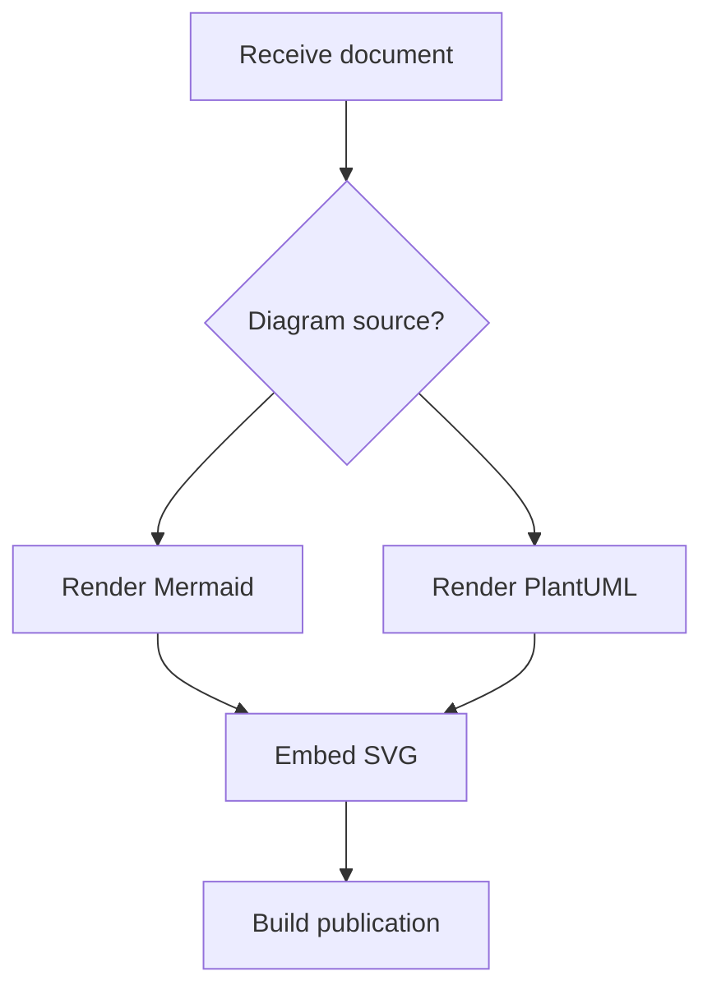

A publication can contain a process flowchart, a database model, a sequence
of API calls, and a project timeline. Keeping those diagrams as text makes
them easier to review alongside the document. Turning them into images
should fit the document build just as naturally.

[Sirena](https://github.com/claricle/sirena) brings that step into Ruby. It
renders Mermaid diagrams and a supported subset of PlantUML class and
sequence diagrams as SVG, through a Ruby API or a command-line tool. You
can describe decisions, grouped processes, class relationships, and nested
interactions, then generate images for your publication without a browser
or a Java toolchain in Sirena's rendering runtime.

## Choose the diagram that fits the document

In our [welcome post](/blog/welcome-to-claricle/), we introduced Claricle as
an image suite for publication pipelines. Sirena creates images from diagram
source, covering several kinds of information an author needs to explain.

| What you need to show | Mermaid diagram types |
| --- | --- |
| Processes, interactions, and data models | Flowchart, sequence, class, state, entity-relationship |
| Systems and their structure | C4, architecture, block, requirement |
| Schedules, histories, and work in progress | Gantt, timeline, Git graph, Kanban, user journey |
| Quantities and comparisons | Pie, Sankey, XY, quadrant, radar, treemap |
| Hierarchies and binary structures | Mindmap, packet |

These are different diagram languages with their own syntax; they share
one rendering entry point in Sirena. The
[diagram reference](https://claricle.github.io/sirena/diagram_types/)
provides syntax and examples for each type. PlantUML support focuses on
class and sequence diagrams, rather than every PlantUML diagram language.

## Flowcharts with decisions and branches

A useful flowchart needs more than two boxes. Mermaid flowcharts in Sirena
can use different node shapes and separate paths to explain a process.

Save this example as `diagram.mmd`. It branches on the source notation,
then brings both rendering paths together before building the publication:



Render it from the command line:

```sh
sirena render diagram.mmd -o diagram.svg
```

<figure class="diagram-result">
  
  <figcaption>Generated <code>diagram.svg</code>, showing the decision and two rendering paths.</figcaption>
</figure>

You can also render the same source inside an application:

```ruby
require "sirena"

source = File.read("diagram.mmd")
svg = Sirena.render(source)
File.write("diagram.svg", svg)
```

The Ruby API returns an SVG string, so an application can save the image or
pass it directly to its document assembly step. For Mermaid flowcharts
that need a different placement strategy, the API also provides an optional
ELK layout through `Sirena.render(source, layout_engine: :elk)`.

## Sequence diagrams with actors and activations

Sequence diagrams can show the conditions around an exchange, not just the
messages themselves. Sirena's Mermaid sequence diagrams include participant
aliases, activation bars, notes, and control blocks. The bundled PlantUML
notation also handles actors, named participants, self-messages, activation,
notes, and loops.

This PlantUML example shows a document build rendering each diagram in a
loop. An actor starts the build, activation bars show when the build and
renderer are working, and a self-message represents an internal step.
Save it as `sequence.puml`:

```text
@startuml
title Rendering a document
actor Author
participant "Document build" as Build
participant Sirena
Author -> Build: Submit document
activate Build
loop Each diagram
  Build -> Sirena: Render source
  activate Sirena
  Sirena -> Sirena: Arrange elements
  Sirena --> Build: SVG diagram
  deactivate Sirena
end
note over Build,Sirena: SVG stays in the publication pipeline
Build --> Author: Document ready
deactivate Build
@enduml
```

Load the bundled notation when rendering:

```sh
sirena render --require sirena/notation/plantuml sequence.puml -o sequence.svg
```

<figure class="diagram-result">
  
  <figcaption>Generated <code>sequence.svg</code> with an actor, activation bars, a self-message, a loop, and a spanning note.</figcaption>
</figure>

The Ruby version uses the same rendering entry point after loading the
notation:

```ruby
require "sirena"
require "sirena/notation/plantuml"

svg = Sirena.render(File.read("sequence.puml"), notation: :plantuml)
File.write("sequence.svg", svg)
```

## Class diagrams with members and relationships

PlantUML class diagrams can describe more than class names. Sirena renders
fields and methods, visibility markers, packages, and relationships such as
inheritance and aggregation, including relationship labels and multiplicity.

For example, this source puts a document model inside a package, records its
members, and shows how a document contains diagrams. `MermaidDiagram`
inherits from `Diagram`:

```text
@startuml
package Publication {
  class Document {
    +title : String
    +build()
  }
  class Diagram {
    +source : String
    +render()
  }
  class MermaidDiagram
  Document "1" o-- "*" Diagram : contains
  Diagram <|-- MermaidDiagram
}
@enduml
```

Save it as `classes.puml` and render it with the same PlantUML notation:

```sh
sirena render --require sirena/notation/plantuml classes.puml -o classes.svg
```

Mermaid class and entity-relationship diagrams offer other ways to describe
object models and database relationships while keeping SVG as the output.

## Themes for the destination

The same diagram may appear in a printed document or on a dark website.
Sirena provides `default`, `light`, `dark`, and `high_contrast` themes, along
with custom YAML themes. Select a theme through either the API or CLI:

```sh
sirena render diagram.mmd --theme dark -o diagram-dark.svg
```

```ruby
svg = Sirena.render(source, theme: "dark")
```

Choosing a theme during rendering lets you generate the image for its
intended destination. SVG keeps shapes and text scalable when the document
resizes the result.

## Render a document's diagrams together

A document build usually has several source files. Sirena's batch command
recursively discovers diagrams and preserves their relative paths in the
output directory. Load the PlantUML notation to include both `.mmd` and
`.puml` sources:

```sh
sirena batch --require sirena/notation/plantuml -i docs/diagrams -o docs/images
```

Keep the source files under `docs/diagrams`, generate their images under
`docs/images`, and reference those SVGs from the document. A failed diagram
does not stop the remaining files from being processed; the summary reports
successes and failures, and the command exits unsuccessfully if any diagram
failed. That gives the build a useful failure signal while showing which
files need attention.

For a pipeline that already produces source on standard output, single-file
rendering can also read standard input and write SVG to standard output:

```sh
cat diagram.mmd | sirena render > diagram.svg
```

Sirena is designed for publication workflows, including SVG for embedding in
Metanorma documents. Start with a representative diagram from your own
project and check it in the final document. The
[repository examples](https://github.com/claricle/sirena/tree/main/examples)
and [documentation](https://claricle.github.io/sirena/)
provide more sources to adapt.
